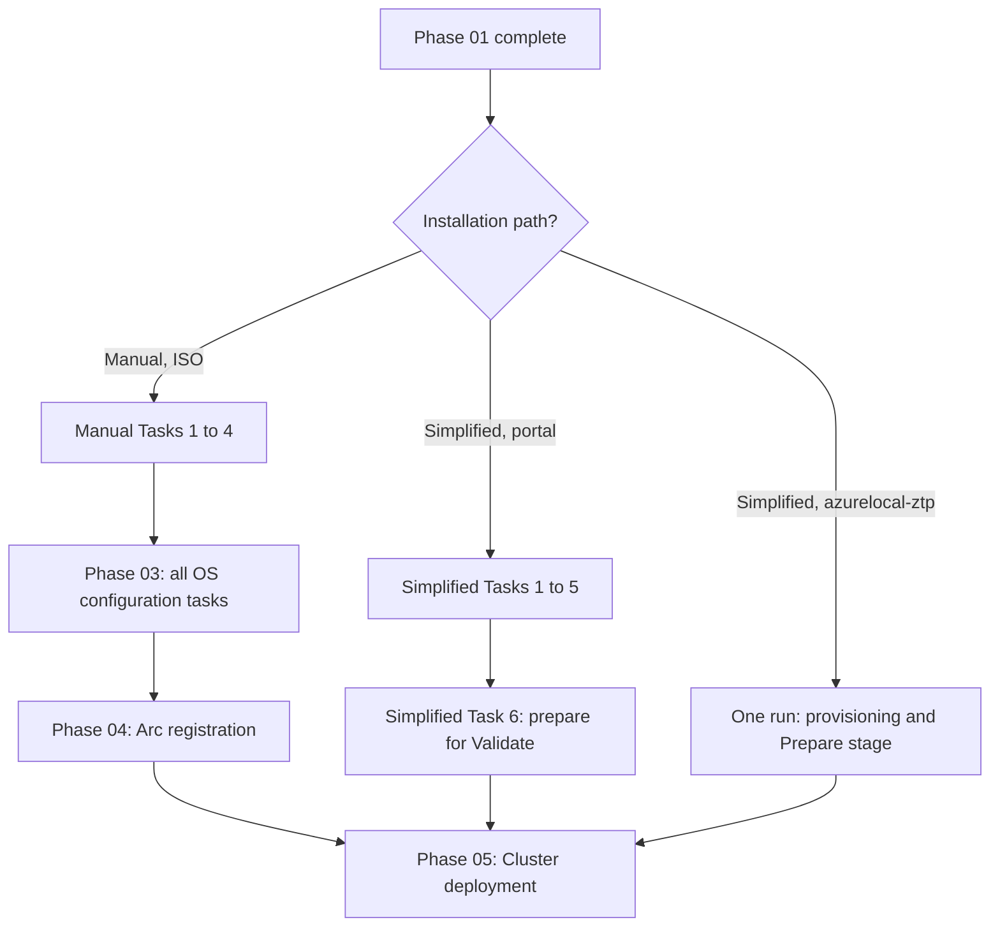

# Phase 02: OS Installation

> **DOCUMENT CATEGORY**: Runbook
> **SCOPE**: Azure Local cluster OS installation
> **PURPOSE**: Choose the OS installation path and follow its tasks
> **MASTER REFERENCE**: [Microsoft Learn — Deploy Azure Local](https://learn.microsoft.com/en-us/azure/azure-local/deploy/deployment-introduction?view=azloc-2610)

**Status**: Active

## Overview

Phase 02 has two paths. Both end with the Azure Stack HCI OS on every node, but they hand over in different states, so the phases after them differ too.

| Path | What it is | Next |
|------|-----------|------|
| **[Manual OS Installation (ISO)](./manual-installation/index.mdx)** | You install from the ISO or your OEM's image on each node through the BMC console. GA. | All of [Phase 03](../phase-03-os-configuration/index.mdx), then [Phase 04](../phase-04-arc-registration/index.mdx) |
| **[Simplified Machine Provisioning](./simplified-provisioning/index.mdx)** | Azure installs the OS, sets the host name and registers the machine with Arc. Preview. By hand in the portal, or fully automated with azurelocal-ztp. | Simplified provisioning Task 06, or the ZTP Prepare stage. Phase 04 is skipped |

[Choose your route](../choose-your-route.mdx) has the flow chart for the whole of Part 4 and a decision matrix of every OS step on each path.

:::tip Zero-touch provisioning: azurelocal-ztp
**Simplified provisioning can run with no one in the rack.** The [azurelocal-ztp](https://azurelocal.cloud/azurelocal-ztp/) automation boots each machine from a virtual USB over the BMC, collects the ownership vouchers, claims the machines in Azure, installs the OEM network drivers and SBE, and checks every machine until it's ready for Validate. One command from a Windows management host, or one pipeline.

- Documentation: [azurelocal.cloud/azurelocal-ztp](https://azurelocal.cloud/azurelocal-ztp/)
- Source: [github.com/AzureLocal/azurelocal-ztp](https://github.com/AzureLocal/azurelocal-ztp)
- On this site: [Automated route](./simplified-provisioning/automation/index.mdx)

Proven on Dell AX-760 with iDRAC 7.30. Not Microsoft-supported.
:::

---

## Path comparison

| Aspect | Manual (ISO) | Simplified provisioning (preview) |
|--------|-------------|-----------------------------------|
| **Status** | ✅ GA, production supported | ⚠️ Preview, East US only |
| **OS installation** | By hand through the iDRAC or BMC console | By Azure |
| **Physical access** | iDRAC virtual media | A USB stick per machine, or none with azurelocal-ztp |
| **Host name** | You set it in Phase 03 | Set by provisioning |
| **OEM drivers and SBE** | In the OEM image, or you install them | You install them (Task 06), or azurelocal-ztp does |
| **Network configuration** | Phase 03 | DHCP from provisioning; static IP, one gateway, DNS and time in Task 06 or by azurelocal-ztp |
| **Azure Arc registration** | Phase 04 | Done by provisioning |
| **Arc machine name** | The host name | `<device-id>-1`, see the [known issue](../choose-your-route.mdx#known-issue-arc-machine-names-at-deploy) |
| **Arc gateway** | ✅ Supported | ❌ Not supported in the preview |
| **Validated hardware** | All [Azure Local catalog](https://aka.ms/AzureStackHCICatalog) hardware | Dell AX-650/750, Lenovo MX650 V3/V4, HPE DL360 Gen11 |

:::tip Recommendation
Use the **manual (ISO)** path for production deployments until simplified provisioning reaches GA. Use simplified provisioning for evaluation, and on its validated hardware in East US.
:::

---

## Path 1: Manual OS Installation (ISO)

| Task | Description | Duration |
|------|-------------|----------|
| 1 | [Delete and Recreate Virtual Disk on Dell BOSS Card](./manual-installation/task-01-delete-and-recreate-virtual-disk-on-dell-boss-card.mdx) | 15 min |
| 2 | [Mount and Verify Dell Gold Image ISO](./manual-installation/task-02-mount-and-verify-dell-gold-image-iso.mdx) | 15 min |
| 3 | [Manual OS Installation](./manual-installation/task-03-manual-os-installation.mdx) | 30–45 min |
| 4 | [Verify OS Deployment](./manual-installation/task-04-verify-os-deployment.mdx) | 15 min |

Start at the [Manual OS Installation overview](./manual-installation/index.mdx).

---

## Path 2: Simplified Machine Provisioning (Preview)

### By hand, in the portal

| Task | Description | Duration |
|------|-------------|----------|
| 1 | [Create USB Installation Media](./simplified-provisioning/task-01-create-usb-media.mdx) | 15 min |
| 2 | [Prepare Machines](./simplified-provisioning/task-02-prepare-machines.mdx) | 30 min per machine |
| 3 | [Provision Machines from Azure](./simplified-provisioning/task-03-provision-from-azure.mdx) | 15 min + wait |
| 4 | [Monitor Machine Setup](./simplified-provisioning/task-04-monitor-progress.mdx) | 30–60 min |
| 5 | [Verify Azure Arc Connectivity](./simplified-provisioning/task-05-verify-arc.mdx) | 10 min |
| 6 | [Prepare Machines for Validate](./simplified-provisioning/task-06-prepare-for-validate.mdx) | 30 min |

### Automated, with azurelocal-ztp

| Page | Description |
|------|-------------|
| [Automation Overview](./simplified-provisioning/automation/index.mdx) | Design, flow chart, stages and gates |
| [Prerequisites](./simplified-provisioning/automation/prerequisites.mdx) | Azure, BMC, network and management host |
| [Operator Inputs](./simplified-provisioning/automation/operator-inputs.mdx) | The environment file and the OEM SBE |
| [Run from a Management Host](./simplified-provisioning/automation/run-from-management-host.mdx) | Plan, run and resume on Windows |
| [Monitor with Sonar](./simplified-provisioning/automation/monitor-with-sonar.mdx) | Follow the run live |
| [Run from a Pipeline](./simplified-provisioning/automation/run-from-pipeline.mdx) | Self-hosted runner, approval before Boot |
| [Output and Handoff](./simplified-provisioning/automation/output-and-handoff.mdx) | Ready for Validate, and the handoff to cluster deployment |

Both: [Troubleshooting and Known Issues](./simplified-provisioning/troubleshooting.mdx).

---

## Workflow

---

## Outcome

- **Manual path:** the OS is on every node. Continue with [Phase 03](../phase-03-os-configuration/index.mdx).
- **Simplified path:** every machine is Ready to cluster in Azure, with OEM drivers, SBE, one static management address, DNS and time. Phase 04 is skipped; continue with [Phase 05](../phase-05-cluster-deployment/index.mdx).

:::warning Before Validate, on either path
Check [Microsoft Learn's OS installation steps](https://learn.microsoft.com/en-us/azure/azure-local/deploy/deployment-install-os?view=azloc-2610) and your OEM's deployment guide for your build and hardware.
:::

---

## Navigation

| | | |
|:--|:--:|--:|
| ← [Phase 01: Hardware Provisioning](../phase-01-hardware-provisioning/index.mdx) | [↑ Cluster Deployment](../index.mdx) | [Phase 03: OS Configuration →](../phase-03-os-configuration/index.mdx) |

---

## Version Control

| Version | Date | Author | Changes |
|---------|------|--------|---------|
| 1.0 | 2026-01-31 | Azure Local Cloud | Initial document |
| 1.1 | 2026-03-04 | Azure Local Cloud | Fix frontmatter, badges, stage references, standards alignment |
| 2.0 | 2026-11-06 | Azure Local Cloud | Split into two paths: Manual OS Installation and Simplified Machine Provisioning; azurelocal-ztp call-out; simplified Task 06 |
