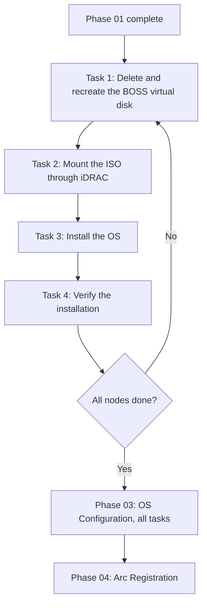

# Manual OS Installation (ISO)

[](../index.mdx)
[](https://learn.microsoft.com/en-us/azure/azure-local/)
[](https://www.dell.com/)

> **DOCUMENT CATEGORY**: Runbook
> **SCOPE**: Azure Local OS installation from an ISO or OEM image
> **PURPOSE**: Install the OS on every node through the BMC virtual console
> **MASTER REFERENCE**: [Microsoft Learn — Install the Azure Stack HCI OS](https://learn.microsoft.com/en-us/azure/azure-local/deploy/deployment-install-os?view=azloc-2610)

**Status**: Active

---

## Overview

This is the GA route: prepare the Dell BOSS boot disk, mount the ISO through iDRAC virtual media, and run the installer on each node. Use it for production deployments and for any hardware in the [Azure Local catalog](https://aka.ms/AzureStackHCICatalog).

After the OS is installed, this route continues with **every** task in [Phase 03: OS Configuration](../../phase-03-os-configuration/index.mdx) and then [Phase 04: Arc Registration](../../phase-04-arc-registration/index.mdx). The [decision matrix](../../choose-your-route.mdx#decision-matrix) shows how that differs from simplified provisioning.

:::warning Important notes
- **BOSS deletion triggers a reboot.** Deleting and recreating the BOSS virtual disk creates a configuration job that needs a reboot to apply.
- **Automatic boot to the ISO.** After that reboot, the server boots from the ISO, because the BOSS disk has no OS yet.
- **Manual installation.** The installer runs through the iDRAC virtual console on each node.
- **Don't domain join before Phase 05** unless you follow Learn's domain-join-before-deployment steps (2604 and later). The deployment joins the nodes.
:::

---

## Tasks

| Task | Description | Duration |
|------|-------------|----------|
| 1 | [Delete and Recreate Virtual Disk on Dell BOSS Card](./task-01-delete-and-recreate-virtual-disk-on-dell-boss-card.mdx) | 15 min |
| 2 | [Mount and Verify Dell Gold Image ISO](./task-02-mount-and-verify-dell-gold-image-iso.mdx) | 15 min |
| 3 | [Manual OS Installation](./task-03-manual-os-installation.mdx) | 30–45 min |
| 4 | [Verify OS Deployment](./task-04-verify-os-deployment.mdx) | 15 min |

---

## Prerequisites

| Requirement | Description | Source |
|-------------|-------------|--------|
| Phase 01 complete | BIOS and iDRAC settings validated and compliant | [Phase 01](../../phase-01-hardware-provisioning/index.mdx) |
| Dell BOSS cards | Boot Optimized Storage Solution cards in all nodes | Hardware |
| iDRAC access | Virtual Console and Virtual Media available | `infrastructure.yml`: `nodes[].bmc.ip_address` |
| OS image | Dell Azure Local gold image ISO, or the Microsoft ISO plus your OEM's drivers | Build team, [Learn](https://learn.microsoft.com/en-us/azure/azure-local/deploy/download-23h2-software?view=azloc-2610) |

---

## Dell BOSS card

The Dell Boot Optimized Storage Solution (BOSS) card provides dedicated boot storage for Azure Local nodes:

| Feature | Description |
|---------|-------------|
| Configuration | Two M.2 SATA SSDs configured as a RAID-1 mirror |
| Purpose | OS boot resilience: an OS failure doesn't affect the data drives |
| Controller | Dell BOSS controller, separate from the storage RAID controller |
| Presentation | A single virtual disk to the OS |
| Requirement | A full delete, create and initialize cycle before a fresh OS install |

:::info Dell gold image
Dell's Azure Local gold image includes Dell's drivers, and from the June 2025 image the SBE files are already in `C:\SBE`. Images from 2609 also update firmware during imaging. Check [Dell's SBE release notes](https://dell.github.io/azurestack-docs/docs/hci/supportmatrix/2606/sbereleasenotes/) for your image before you go on.
:::

---

## Workflow



---

## Quick check before you start

Verify iDRAC access for all nodes. iDRAC addresses are in `infrastructure.yml` under `nodes[].bmc.ip_address`.

```powershell
# Test iDRAC connectivity for all nodes (run from the toolkit root)
Import-Module ./scripts/common/infrastructure/AzlInfrastructure.psm1
$infra = Import-AzlInfrastructure -Path ./infrastructure.yml
$infra.nodes | ForEach-Object {
  $ip = $_.bmc.ip_address
  $result = Test-NetConnection -ComputerName $ip -Port 443 -WarningAction SilentlyContinue
  $status = if ($result.TcpTestSucceeded) { "Reachable" } else { "Unreachable" }
  Write-Host "$($_.name) iDRAC ($ip): $status"
}
```

---

## Validation

- [ ] BOSS virtual disks deleted and recreated on all nodes
- [ ] Gold image ISO mounted and verified on all nodes (`Inserted: true`)
- [ ] Nodes rebooted and booted from the ISO after the BOSS recreation
- [ ] Azure Stack HCI OS installed on the BOSS RAID-1 volume of every node
- [ ] Administrator passwords set and stored in Key Vault
- [ ] All nodes boot to the Server Core prompt
- [ ] Task 4 checklist passed

---

## Navigation

| | | |
|:--|:--:|--:|
| ← [Phase 02: OS Installation](../index.mdx) | [↑ Phase 02: OS Installation](../index.mdx) | [Task 01: BOSS Card →](./task-01-delete-and-recreate-virtual-disk-on-dell-boss-card.mdx) |

---

| Version | Date | Author | Changes |
|---------|------|--------|---------|
| 1.0 | 2026-11-06 | Azure Local Cloud | Split from the Phase 02 overview into its own path |
