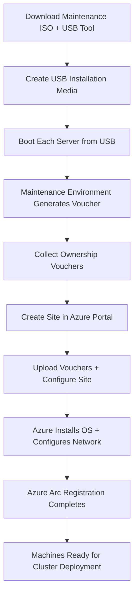

import Tabs from '@theme/Tabs';
import TabItem from '@theme/TabItem';

# Simplified Machine Provisioning (Preview)

> **DOCUMENT CATEGORY**: Runbook
> **SCOPE**: Azure Local OS installation via simplified provisioning
> **PURPOSE**: Install OS and register machines from Azure using FIDO Device Onboarding
> **MASTER REFERENCE**: [Microsoft Learn — Simplified Machine Provisioning](https://learn.microsoft.com/en-us/azure/azure-local/deploy/simplified-machine-provisioning?view=azloc-2609)

**Status**: Active

:::tip Zero-touch provisioning: we automate this whole route with azurelocal-ztp
**You don't have to do these tasks by hand.** [azurelocal-ztp](https://azurelocal.cloud/azurelocal-ztp/) runs simplified provisioning end to end with no one in the rack and no USB stick:

1. Builds a virtual USB image per machine and boots every machine from it over the BMC (Redfish)
2. Reads each ownership voucher back and claims the machines in Azure with Bicep
3. Waits for Ready to cluster, and resubmits a failed OS install once
4. Verifies each management address, puts back any BIOS value it changed for the install only, and ends at the **Handoff**: Provisioned and Arc-connected

One environment file is the only input. [OS configuration](../phase-03-os-configuration/automated-os-configuration.mdx) (OEM drivers and SBE, static address, one gateway, DNS, time, host name, deployment admin) follows the Handoff. Run it from a Windows management host or a pipeline, and follow it live with [Sonar](./automation/monitor-with-sonar.mdx).

| Where | Link |
|-------|------|
| Documentation | [azurelocal.cloud/azurelocal-ztp](https://azurelocal.cloud/azurelocal-ztp/) |
| Source and releases | [github.com/AzureLocal/azurelocal-ztp](https://github.com/AzureLocal/azurelocal-ztp) |
| On this site | [Automated route](./automation/index.mdx): prerequisites, inputs, running it, output |

Proven on Dell AX-760 with iDRAC 7.30. Not Microsoft-supported.
:::
:::warning Preview Feature
Simplified machine provisioning is currently **in preview**. Review the [Supplemental Terms of Use for Microsoft Azure Previews](https://azure.microsoft.com/support/legal/preview-supplemental-terms/) before using in production.

- **Supported region**: East US only (preview)
- **Arc Gateway**: Not supported in this preview release
- **Production recommendation**: Use [manual ISO installation](../manual-installation/index.mdx) for production deployments until this feature reaches GA
:::

:::note Status re-checked for release 12.2609
Microsoft introduced simplified machine provisioning in release 2603 and still labels it preview in the 2609 documentation. The region (East US only) and Arc gateway limits above are unchanged. Re-check the [Learn article](https://learn.microsoft.com/en-us/azure/azure-local/deploy/simplified-machine-provisioning?view=azloc-2609) before each pilot.
:::

:::warning Handle ownership vouchers like credentials
An ownership voucher (a .pem file named after the machine serial number) is the proof that lets Azure claim a machine. Anyone holding it might try to claim that machine into their own tenant. Store vouchers in a secured, backed-up location until provisioning completes, then delete them. The maintenance environment uses documented default credentials until the target OS is installed, so keep the machines on an isolated network during preparation.
:::

---

## Overview

Simplified machine provisioning offers an alternative to manual ISO installation. Instead of creating boot media, connecting to each server's management interface, and manually running Windows Setup, this workflow:

1. **Prepares machines** with a USB-based maintenance environment that generates [FIDO Device Onboarding (FDO)](https://fidoalliance.org/device-onboarding-overview/) ownership vouchers
2. **Provisions machines from Azure** — the OS is downloaded and installed automatically, with network configuration and Azure Arc registration handled remotely
3. **Deploys the cluster** using the provisioned machines, just as with ISO-based installation

This approach is most valuable when someone other than on-site staff prepares the machines (e.g., a hardware manufacturer or integrator), and on-site staff simply power them on and connect them to the network.

---

## ISO vs Simplified Provisioning Comparison

| Aspect | ISO (Manual) | Simplified Provisioning (Preview) |
|--------|-------------|-----------------------------------|
| **Status** | GA — production supported | Preview — East US only |
| **OS Installation** | Manual via iDRAC/BMC virtual console | Automated from Azure |
| **Physical Access** | Required for initial ISO boot | Required for initial USB boot |
| **Network Configuration** | Manual (SConfig or PowerShell) | Automated from Azure portal |
| **Azure Arc Registration** | Separate step (Phase 04) | Included in provisioning flow |
| **Arc Gateway Support** | ✅ Supported | ❌ Not supported (preview) |
| **Supported Hardware** | All Azure Local Catalog hardware | Dell AX-650/750, Lenovo MX650 V3/V4, HPE DL360 Gen11 |
| **Best For** | Production deployments, all hardware | Automated provisioning of supported SKUs |

---

## Supported Hardware SKUs

| Vendor | Model | BMC |
|--------|-------|-----|
| Dell | AX-650, AX-750 | iDRAC |
| Lenovo | ThinkAgile MX650 V3, MX650 V4 | XCC |
| HPE | ProLiant DL360 Gen11 | iLO |

---

## Choose your route

This section covers two routes to the same end state: machines with the OS installed and registered with Azure Arc, ready for cluster deployment.

| | Portal route (Tasks 1 to 5) | Automated route (azurelocal-ztp) |
|--|-----------------------------|----------------------------------|
| **How** | You create USB media, boot each machine, collect vouchers, and provision in the Azure portal | One command, or one pipeline, from a Windows management host |
| **Physical access** | Someone attaches USB media and powers on each machine | None after the machines are racked, cabled and reachable by BMC |
| **Needs** | Windows 11 PC, USB drive, the Azure portal | Windows management host with BMC access and an environment file |
| **Ends at** | Ready for Validate after Task 6 (drivers, SBE, static IP, one gateway, DNS, time), or after Phase 03 | The Handoff: Provisioned and Arc-connected. Phase 03 OS configuration (automated or by hand) follows |
| **Support** | Microsoft's documented steps (preview) | Proven on Dell AX-760 / iDRAC 7.30. Not on Learn's validated list for this flow |
| **Start here** | [Task 1: Create USB Installation Media](./task-01-create-usb-media.mdx), through [Task 6](./task-06-prepare-for-validate.mdx) | [Zero-Touch Provisioning Automation](./automation/index.mdx) |

Both routes share the same preview limits: East US only and no Arc gateway. If something goes wrong on either route, see [Troubleshooting and Known Issues](./troubleshooting.mdx).

---

## Workflow Overview

The following diagram is the portal route. The flow chart for the automated route is on the [automation overview](./automation/index.mdx#the-flow).

---

## Prerequisites

### Hardware

| Requirement | Details |
|-------------|---------|
| Validated hardware SKU | Dell AX-650/750, Lenovo MX650 V3/V4, or HPE DL360 Gen11 |
| USB flash drive | At least 8 GB, one per prep session |
| Windows 11 PC | Reliable internet connection and USB port for media creation |
| USB port on servers | Required for booting the maintenance environment |

### Azure

| Requirement | Details |
|-------------|---------|
| Feature registration | `az feature register --namespace Microsoft.DeviceOnboarding --name AzureLocalZTP` |
| Resource providers | Microsoft.HybridCompute, Microsoft.AzureStackHCI, Microsoft.DeviceOnboarding, Microsoft.Edge, Microsoft.GuestConfiguration, Microsoft.HybridConnectivity, Microsoft.KeyVault, Microsoft.ManagedIdentity, Microsoft.PolicyInsights, Microsoft.Storage, Microsoft.Insights |
| Permissions | Resource group Owner, or Contributor + RBAC Administrator |
| Region | East US (preview limitation) |

---

## Steps in This Section

### Portal route

| Task | Description | Duration |
|------|-------------|----------|
| 1 | [Create USB Installation Media](./task-01-create-usb-media.mdx) | 15 min |
| 2 | [Prepare Machines](./task-02-prepare-machines.mdx) | 30 min per machine |
| 3 | [Provision Machines from Azure](./task-03-provision-from-azure.mdx) | 15 min + wait |
| 4 | [Monitor Machine Setup](./task-04-monitor-progress.mdx) | 30–60 min |
| 5 | [Verify Azure Arc Connectivity](./task-05-verify-arc.mdx) | 10 min |
| 6 | [Prepare Machines for Validate](./task-06-prepare-for-validate.mdx) | 30 min |

### Automated route (azurelocal-ztp)

| Page | Description |
|------|-------------|
| [Automation Overview](./automation/index.mdx) | Design, flow chart, stages and gates, parallel machines, resume |
| [Prerequisites](./automation/prerequisites.mdx) | Azure, hardware and BMC, network paths, management host |
| [Operator Inputs](./automation/operator-inputs.mdx) | The environment file, and where the SBE belongs |
| [Run from a Management Host](./automation/run-from-management-host.mdx) | Plan, run, watch and resume on Windows |
| [Run from a Pipeline](./automation/run-from-pipeline.mdx) | Self-hosted Windows runner, identity, Key Vault, approval before Boot |
| [Monitor with Sonar](./automation/monitor-with-sonar.mdx) | Follow the run live, read-only |
| [Output and Handoff](./automation/output-and-handoff.mdx) | The Handoff, and what to give OS configuration and cluster deployment |

### Both routes

| Page | Description |
|------|-------------|
| [Troubleshooting and Known Issues](./troubleshooting.mdx) | Known issues, causes, and Microsoft Learn's recovery steps |

---

## Outcome

Upon completion of this section:

- All Azure Local machines have the Azure Stack HCI OS installed, with the host name set by provisioning
- All machines are registered with Azure Arc, with the mandatory extensions
- After [Task 6](./task-06-prepare-for-validate.mdx), or [Phase 03 OS configuration](../../phase-03-os-configuration/index.mdx) after the azurelocal-ztp Handoff: OEM drivers and SBE, one static management address with one gateway, DNS and time
- [Phase 04](../../phase-04-arc-registration/index.mdx) is skipped. Continue with [Phase 05: Cluster Deployment](../../phase-05-cluster-deployment/index.mdx). See the [decision matrix](../../choose-your-route.mdx#decision-matrix)
---

Follow a running provisioning and deployment live with [azurelocal-sonar](https://azurelocal.cloud/azurelocal-sonar/), and check endpoints and network readiness first with [azurelocal-beacon](https://azurelocal.cloud/azurelocal-beacon/).

---

## Navigation

| | | |
|:--|:--:|--:|
| ← [Phase 02: OS Installation](../index.mdx) | [↑ Cluster Deployment](../../index.mdx) | [Task 01: Create USB Media →](./task-01-create-usb-media.mdx) |

---

## References

- [Microsoft Learn — Simplified Machine Provisioning](https://learn.microsoft.com/en-us/azure/azure-local/deploy/simplified-machine-provisioning?view=azloc-2609)
- [Microsoft Learn — Install OS via ISO](https://learn.microsoft.com/en-us/azure/azure-local/deploy/deployment-install-os?view=azloc-2609)
- [FIDO Device Onboarding Overview](https://fidoalliance.org/device-onboarding-overview/)
- [Microsoft Learn — Troubleshoot Simplified Machine Provisioning](https://learn.microsoft.com/en-us/azure/azure-local/deploy/troubleshoot-simplified-machine-provisioning?view=azloc-2610)
- [azurelocal-ztp — BMC/Redfish Automation](https://github.com/AzureLocal/azurelocal-ztp)

---

| Version | Date | Author | Changes |
|---------|------|--------|---------|
| 1.0 | 2026-05-01 | Azure Local Cloud | Initial release — Simplified Provisioning (Preview) |
| 1.1 | 2026-11-05 | Azure Local Cloud | Add the automated route (azurelocal-ztp), a troubleshooting page and a route comparison |
