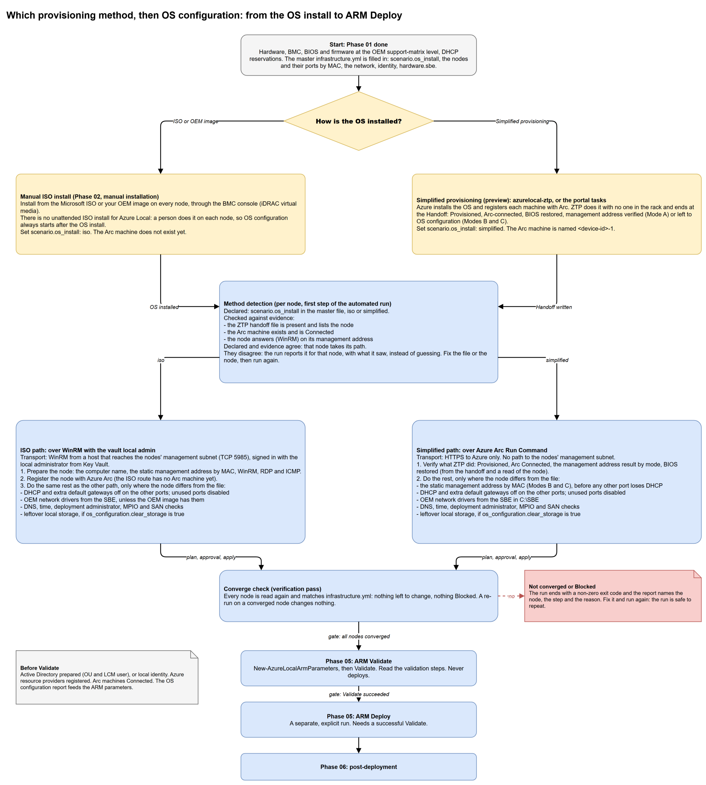
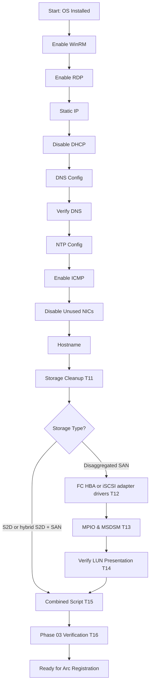

# Phase 03: OS Configuration

> **DOCUMENT CATEGORY**: Runbook   
> **SCOPE**: Post-installation OS configuration   
> **PURPOSE**: Prepare nodes for Azure Arc registration   
> **MASTER REFERENCE**: [Microsoft Learn - Install the Azure Local operating system](https://learn.microsoft.com/en-us/azure/azure-local/deploy/deployment-install-os?view=azloc-2610)

**Status**: Active 
**Estimated Time**: 45-60 minutes (all nodes) 
**Last Updated**: 2026-11-08

---

## Overview

## Start here: the automated run

OS configuration always starts **after** the OS install, whichever way it was done. The toolkit does the whole phase for the whole cluster in one run: it reads each node, changes only what differs from the master `infrastructure.yml`, and reports. Use it unless you cannot; the manual tasks below do the same work one setting at a time.

| Page | What it gives you |
|------|-------------------|
| [Which method did I use?](./which-method-then-os-configuration.mdx) | The decision flow from the OS install (azurelocal-ztp or a manual ISO install) to ARM Deploy, method detection, and how to tell which method you used |
| [Automated OS configuration (one run)](./automated-os-configuration.mdx) | The commands (standalone and from a GitHub or GitLab pipeline), the master-file keys, `clear_storage`, the SBE delivery route, exit codes, access and connectivity, and troubleshooting |
| [How the run works](./how-the-run-works.mdx) | Every step in the order it runs, what counts as a change, restarts, the three management address modes, SAN-only steps |

:::info Installed with simplified machine provisioning?
Provisioning sets the host name, registers the machine with Arc and installs the mandatory extensions. [azurelocal-ztp](../phase-02-os-installation/simplified-provisioning/automation/index.mdx) ends at the Handoff: it does **not** install the OEM drivers or the SBE, set DNS or time, create the deployment administrator, or turn DHCP and the default gateway off on the other ports, and in management Modes B and C the static address is not in place. The automated run does all of that, starting from the handoff. See the [decision matrix](../choose-your-route.mdx#decision-matrix) for each task, and check [Microsoft Learn](https://learn.microsoft.com/en-us/azure/azure-local/deploy/deployment-install-os?view=azloc-2610) and your OEM's deployment guide for your build before Validate.
:::

---

## Manual tasks

This stage configures the Azure Stack HCI operating system on all cluster nodes with the settings required for Azure Local deployment. All steps can be performed remotely once WinRM is enabled.

**Objective:** Configure the Azure Local operating system on each node with network settings, remote management, and baseline configuration required for cluster deployment.

**Tasks:**

1. Enable WinRM for PowerShell remote management
2. Enable RDP for graphical remote access
3. Configure static IP addresses on management adapters
4. Disable DHCP on management adapters
5. Configure DNS server addresses
6. Verify DNS client configuration
7. Configure NTP time synchronization
8. Enable ICMP firewall rules for network diagnostics
9. Disable unused network adapters
10. Set node hostnames
11. Clear previous storage configuration (conditional — redeployments on used hardware; local disks only, never SAN LUNs)
12. Install FC HBA drivers or OEM iSCSI adapter drivers (conditional — disaggregated SAN deployments)
13. Verify MPIO, register and claim the vendor MSDSM (conditional — disaggregated SAN deployments)
14. Verify SAN LUN presentation (conditional — disaggregated SAN deployments)
15. Optional: Run complete combined script (Tasks 02–10)
16. Phase 03 Verification

**Validation:**

- Remote management operational (WinRM and RDP)
- Static network configuration applied
- DNS resolution functional
- Time synchronization configured
- Nodes accessible and properly named

**Outcome:** All nodes configured with proper network settings, remote management enabled, and ready for Azure Arc registration (Stage 13).

---

## Configuration Workflow

---

## Steps Overview

| Step | Description | Time | Applies To |
|------|-------------|------|-----------|
| [Task 01](./task-01-enable-winrm-for-remote-management.mdx) | Enable WinRM for Remote Management | 5 min | All |
| [Task 02](./task-02-enable-rdp.mdx) | Enable RDP (Remote Desktop Protocol) | 5 min | All |
| [Task 03](./task-03-configure-static-ip-address.mdx) | Configure Static IP Address | 10 min | All |
| [Task 04](./task-04-disable-dhcp-on-management-adapter.mdx) | Disable DHCP on Management Adapter | 5 min | All |
| [Task 05](./task-05-configure-dns-servers.mdx) | Configure DNS Servers | 5 min | All |
| [Task 06](./task-06-verify-dns-client-configuration.mdx) | Verify DNS Client Configuration | 5 min | All |
| [Task 07](./task-07-configure-time-synchronization-ntp.mdx) | Configure Time Synchronization (NTP) | 5 min | All |
| [Task 08](./task-08-enable-icmp-ping.mdx) | Enable ICMP (Ping) | 5 min | All |
| [Task 09](./task-09-disable-unused-network-adapters.mdx) | Disable Unused Network Adapters | 5 min | All |
| [Task 10](./task-10-configure-hostname.mdx) | Configure Hostname | 5 min | All |
| [Task 11](./task-11-clear-previous-storage-configuration-conditional.mdx) | Clear Previous Storage Configuration (local disks only) | 5 min | Redeployment on used hardware |
| [Task 12](./task-12-install-fc-hba-drivers-conditional.mdx) | Install FC HBA Drivers (and iSCSI adapter drivers) | 15 min | Disaggregated SAN only |
| [Task 13](./task-13-configure-mpio-and-vendor-msdsm-conditional.mdx) | Verify MPIO, Register and Claim Vendor MSDSM | 15 min | Disaggregated SAN only |
| [Task 14](./task-14-verify-san-lun-presentation-conditional.mdx) | Verify SAN LUN Presentation | 10 min | Disaggregated SAN only |
| [Task 15](./task-15-complete-combined-script-all-steps.mdx) | Complete Combined Script | N/A | Optional |
| [Task 16](./task-16-phase03-verification.mdx) | Phase 03 Verification | 10 min | All |

---

## Prerequisites

| Requirement | Description |
|-------------|-------------|
| OS installed | Stage 11 completed |
| iDRAC access | Console access for initial config |
| IP planning | Static IPs assigned per node |
| DNS servers | Enterprise DNS available |
| NTP server | Time source identified |

---

## Variables from infrastructure.yaml

The following variables are used during OS configuration:

| Variable | Description | Example |
|----------|-------------|---------|
| `NODE_XX_IP` | Static IP address for each node | `192.168.200.11` |
| `NODE_XX_NAME` | Hostname for each node | `azlocal-node01` |
| `MANAGEMENT_GATEWAY` | Default gateway IP | `192.168.200.1` |
| `MANAGEMENT_SUBNET_PREFIX` | Subnet prefix length | `24` |
| `DNS_PRIMARY_IP` | Primary DNS server IP | `192.168.200.2` |
| `DNS_SECONDARY_IP` | Secondary DNS server IP | `192.168.200.3` |
| `NTP_SERVER` | NTP server IP or hostname | `pool.ntp.org` |

---

## Network Configuration Reference

**Example Node Configuration**:

| Node | Management IP | Gateway | DNS1 | DNS2 |
|------|---------------|---------|------|------|
| NODE01 | 10.x.x.11 | 10.x.x.1 | 10.x.x.2 | 10.x.x.3 |
| NODE02 | 10.x.x.12 | 10.x.x.1 | 10.x.x.2 | 10.x.x.3 |
| NODE03 | 10.x.x.13 | 10.x.x.1 | 10.x.x.2 | 10.x.x.3 |
| NODE04 | 10.x.x.14 | 10.x.x.1 | 10.x.x.2 | 10.x.x.3 |

---

## Automation Options

**Manual**: Follow each step in sequence.

**Automated, the whole phase**: the [automated run](./automated-os-configuration.mdx) covers every task on this page for every node, with method detection, a plan, an approval gate and a verification pass.

**Automated, Tasks 02–10 only**: [Task 15: Combined Script](./task-15-complete-combined-script-all-steps.mdx).

**Disaggregated SAN deployments**: Run Tasks 12–14 after Task 11 before running the combined script. Zone the FC fabric and unmask the infrastructure and performance history LUNs now, before Arc registration, and leave them RAW. On iSCSI with 2610, do not enable iSCSI on the machines first; the deployment wizard configures it.

**Hybrid (Storage Spaces Direct + SAN)**: Skip Tasks 12–14 for the initial deployment. Learn attaches the SAN after the initial deployment (2604 or later) and says: "don't zone in FC HBA World Wide Names (WWNs) until after the Azure Local deployment." Follow [Connect an external storage array to Azure Local](https://learn.microsoft.com/en-us/azure/azure-local/deploy/enable-external-storage?view=azloc-2610) once the cluster is deployed.

---

## Validation Checklist

| Check | Required |
|-------|----------|
| WinRM responds | ✅ |
| RDP accessible | ✅ |
| Static IP configured | ✅ |
| DNS resolution works | ✅ |
| Time synchronized | ✅ |
| Hostname correct | ✅ |
| FC HBA ports visible (disaggregated SAN only) | ⚙️ |
| MPIO verified, vendor registered and claimed (disaggregated SAN only) | ⚙️ |
| Infrastructure and performance history LUNs RAW (disaggregated SAN only) | ⚙️ |

---

## Next Stage

After completing OS configuration:

| All Steps Complete? | Next Action |
|---------------------|-------------|
| ✅ Yes, installed from the ISO | Proceed to [Phase 04: Arc Registration](../phase-04-arc-registration/index.mdx), unless the automated run already registered the nodes |
| ✅ Yes, installed with simplified provisioning | Skip Phase 04: the machines are already Arc-connected. Go to [Phase 05: Cluster Deployment](../phase-05-cluster-deployment/index.mdx) after Active Directory preparation |
| ❌ No | Complete remaining configuration steps |

---

**References**:
- [Microsoft Learn - Install the Azure Local operating system](https://learn.microsoft.com/en-us/azure/azure-local/deploy/deployment-install-os?view=azloc-2610)
- [Microsoft Learn - Install the OS for disaggregated deployments](https://learn.microsoft.com/en-us/azure/azure-local/deploy/deployment-install-os-disaggregated?view=azloc-2610)
- [Microsoft Learn - Connect an external storage array to Azure Local](https://learn.microsoft.com/en-us/azure/azure-local/deploy/enable-external-storage?view=azloc-2610)
- [Microsoft Learn - Azure Local deployment prerequisites](https://learn.microsoft.com/en-us/azure/azure-local/deploy/deployment-prerequisites?view=azloc-2610)
