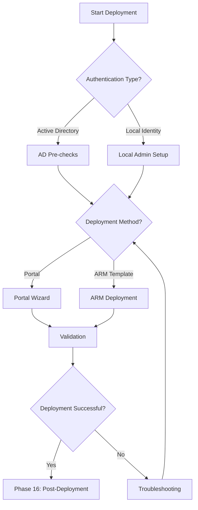

# Phase 05: Cluster Deployment

> **DOCUMENT CATEGORY**: Runbook   
> **SCOPE**: Azure Local cluster deployment   
> **PURPOSE**: Deploy the cluster through Azure Portal or ARM templates   
> **MASTER REFERENCE**: [Microsoft Learn - Deploy Azure Local](https://learn.microsoft.com/en-us/azure/azure-local/deploy/deploy-via-portal?view=azloc-2610)

**Status**: Active 
**Estimated Time**: 1.5-3 hours (Learn gives 2.5-3 hours for the ARM deployment itself) 
**Last Updated**: 2026-11-08 (verified against Microsoft Learn `view=azloc-2610`)

---

## Overview

This stage deploys the Azure Local cluster using the configured infrastructure. Deployment can be performed through the Azure Portal (GUI-based) or ARM templates (infrastructure-as-code). Azure Local Cloud supports both Active Directory and Local Identity authentication methods.

:::warning Before Validate
Every machine needs its OS steps done first: OEM drivers and SBE, one static management address with one default gateway, DNS and time. Which ones you run yourself depends on your route; see the [decision matrix](../choose-your-route.mdx#decision-matrix). Check [Microsoft Learn](https://learn.microsoft.com/en-us/azure/azure-local/deploy/deployment-install-os?view=azloc-2610) and your OEM's deployment guide for your build.

**Simplified provisioning:** pass each machine's `arcMachineResourceId` from Azure (named `<device-id>-1`), and read the [known issue with Arc machine names at Deploy](../choose-your-route.mdx#known-issue-arc-machine-names-at-deploy) before you deploy.
:::

---

## Deployment Methods

### Storage Spaces Direct (S2D) — Hyperconverged

| Method | Authentication | Use Case |
|--------|---------------|----------|
| [Portal - Active Directory](./deployment-methods/s2d/active-directory/portal-instructions.mdx) | Domain-joined | Standard enterprise deployment |
| [ARM Template - Active Directory](./deployment-methods/s2d/active-directory/arm-template-instructions.mdx) | Domain-joined | Automated/repeatable deployment |
| [Portal - Local Identity](./deployment-methods/s2d/local-identity/portal-instructions.mdx) | Local accounts | Edge/disconnected scenarios |
| [ARM Template - Local Identity](./deployment-methods/s2d/local-identity/arm-template-instructions.mdx) | Local accounts | Automated edge deployment |

### Storage Area Network (SAN) — Disaggregated

| Method | Authentication | Use Case |
|--------|---------------|----------|
| [Portal - Active Directory (SAN)](./deployment-methods/san/active-directory/portal-instructions.mdx) | Domain-joined | SAN with enterprise AD |
| [ARM Template - Active Directory (SAN)](./deployment-methods/san/active-directory/arm-template-instructions.mdx) | Domain-joined | SAN with automated deployment |
| [Portal - Local Identity (SAN)](./deployment-methods/san/local-identity/portal-instructions.mdx) | Local accounts | SAN at edge without AD |
| [ARM Template - Local Identity (SAN)](./deployment-methods/san/local-identity/arm-template-instructions.mdx) | Local accounts | SAN with automated edge |

:::info Choosing Your Storage Type
- **S2D (Hyperconverged)**: Local NVMe/SSD/HDD in each node, up to 16 nodes. Compute and storage scale together.
- **SAN (Disaggregated)**: External SAN via Fibre Channel or iSCSI, up to 64 nodes. Compute and storage scale independently. See [SAN Deployment](./deployment-methods/san/index.mdx) for prerequisites and network patterns.
- **Hybrid (S2D + SAN)**: a SAN attached to a hyperconverged cluster after initial deployment (version 2604 or later). It is a day-2 operation, see [Connect an external storage array to Azure Local](https://learn.microsoft.com/en-us/azure/azure-local/deploy/enable-external-storage?view=azloc-2610).
:::

:::tip Azure Local Cloud Standard
For Azure Local Cloud Azure Local deployments, **Active Directory with ARM Template** is the recommended approach for consistency and repeatability.
:::

---

## Prerequisites

### All Deployment Methods

| Requirement | Validation |
|-------------|------------|
| Arc registration complete (Phase 04) | All nodes show "Connected" in Azure Portal |
| Network infrastructure configured | Management, storage, and compute networks ready |
| Required Azure permissions | Subscription: user access administrator and contributor. Resource group used for the Arc machines: Azure Stack HCI Administrator, Reader, Key Vault Data Access Administrator, Key Vault Secrets Officer, Key Vault Contributor, Storage Account Contributor, plus Azure Connected Machine Onboarding and Azure Connected Machine Resource Administrator |
| Storage infrastructure ready | S2D: physical disks clean and enclosures configured. SAN: infrastructure LUN (250 GB or more) and performance history LUN (20 GB or more) visible and RAW |

### Active Directory Deployments Only

| Requirement | Validation |
|-------------|------------|
| AD pre-created with `New-HciAdObjectsPreCreation` | OU exists, LCM user created in OU, GPO inheritance blocked at OU level |
| Nodes in workgroup (default) or domain-joined before deployment (optional, 2604 and later) | `(Get-WmiObject Win32_ComputerSystem).Domain` returns `WORKGROUP`, or the domain name if you joined first. If domain-joined, the deployment user is in the local Administrators group. If not joined, the wizard joins the machines to the domain during deployment |
| DNS resolves the AD domain FQDN from all nodes | `Resolve-DnsName <domain.fqdn>` succeeds on each node |

### Local Identity Deployments Only

| Requirement | Validation |
|-------------|------------|
| Non-built-in local admin account with identical credentials on ALL nodes | Account is NOT the built-in Administrator; login succeeds on each node |
| Nodes remain in workgroup | `(Get-WmiObject Win32_ComputerSystem).Domain` returns `WORKGROUP` |
| Azure Key Vault available | Existing KV accessible (an existing Key Vault with Private Endpoints is not supported), or will be created during portal deployment |
| DNS server with zone configured for cluster nodes | `Resolve-DnsName <node-fqdn>` succeeds for each node |

---

## Deployment Workflow

---

## Azure Portal Deployment Overview

The Azure Portal deployment wizard guides you through:

1. **Basics** - Subscription, resource group, cluster name, region
2. **Configuration** - Node configuration, witness, and storage settings
3. **Networking** - Management, compute, and storage network settings
4. **Management** - Update settings, key vault integration
5. **Tags** - Resource tagging for governance
6. **Validation** - Pre-deployment checks
7. **Review + Create** - Final review and deployment

---

## ARM Template Deployment Overview

ARM template deployments provide:

- **Repeatability** - Consistent deployments across environments
- **Version Control** - Track infrastructure changes in Git
- **Automation** - Integrate with CI/CD pipelines
- **Compliance** - Audit trail of infrastructure changes

:::info Azure Local Cloud ARM Templates
Azure Local Cloud parameter templates are maintained in the Azure Local Toolkit:

**Toolkit location:** `configs/azure/arm-templates/04-cluster-deployment/`
- `azuredeploy.parameters.ad.json` — Active Directory authentication
- `azuredeploy.parameters.local-identity.json` — Local Identity authentication

**Microsoft official templates:** Pull at deploy time from the [Azure Quickstart Templates](https://github.com/Azure/azure-quickstart-templates/tree/master/quickstarts/microsoft.azurestackhci) repository. Do not modify the main template — customize only via the parameters file. Template per scenario (Learn 2610):

| Scenario | Quickstart template |
|----------|--------------------|
| S2D, Active Directory | `azurestackhci/create-cluster` |
| Local identity (hyperconverged) | `azurestackhci/create-adless-cluster-external-dns-public-preview` |
| Disaggregated, Fibre Channel | `azurestackhci/create-cluster-san` |
| Disaggregated, iSCSI | `azurestackhci/create-cluster-san-iscsi` |

Learn documents no ARM template for SAN plus local identity.
:::

:::note Deployment authentication
Starting with software version 12.2512, new deployments no longer create a Microsoft Entra ID application (service principal). The cluster authenticates to Azure with a system-assigned managed identity.
:::

---

## Estimated Deployment Time

| Phase | Duration |
|-------|----------|
| Pre-deployment validation | 15-30 minutes |
| Cluster deployment | 45-90 minutes |
| Extension installation | 15-30 minutes |
| Post-deployment validation | 15-30 minutes |
| **Total** | **1.5-3 hours** |

---

## Next Steps

Select your deployment method:

### S2D (Hyperconverged)

| Authentication | Method | Link |
|---------------|--------|------|
| Active Directory | Portal | [Portal Instructions](./deployment-methods/s2d/active-directory/portal-instructions.mdx) |
| Active Directory | ARM Template | [ARM Template Instructions](./deployment-methods/s2d/active-directory/arm-template-instructions.mdx) |
| Local Identity | Portal | [Portal Instructions](./deployment-methods/s2d/local-identity/portal-instructions.mdx) |
| Local Identity | ARM Template | [ARM Template Instructions](./deployment-methods/s2d/local-identity/arm-template-instructions.mdx) |

### SAN (Disaggregated)

| Authentication | Method | Link |
|---------------|--------|------|
| Active Directory | Portal | [Portal Instructions (SAN)](./deployment-methods/san/active-directory/portal-instructions.mdx) |
| Active Directory | ARM Template | [ARM Template Instructions (SAN)](./deployment-methods/san/active-directory/arm-template-instructions.mdx) |
| Local Identity | Portal | [Portal Instructions (SAN)](./deployment-methods/san/local-identity/portal-instructions.mdx) |
| Local Identity | ARM Template | [ARM Template Instructions (SAN)](./deployment-methods/san/local-identity/arm-template-instructions.mdx) |

After completing cluster deployment, proceed to [Phase 16: Post Deployment](../phase-06-post-deployment/index.mdx).

---

## Navigation

| Previous | Up | Next |
|----------|-----|------|
| [Phase 14: Arc Registration](../phase-04-arc-registration/) | [Cluster Deployment Index](../index.mdx) | [Phase 16: Post-Deployment](../phase-06-post-deployment/) |

---

**References**:
- [Microsoft Learn - Deploy via Portal](https://learn.microsoft.com/en-us/azure/azure-local/deploy/deploy-via-portal?view=azloc-2610)
- [Microsoft Learn - Deploy via ARM Template](https://learn.microsoft.com/en-us/azure/azure-local/deploy/deployment-azure-resource-manager-template?view=azloc-2610)
- [Microsoft Learn - Deployment Prerequisites](https://learn.microsoft.com/en-us/azure/azure-local/deploy/deployment-prerequisites?view=azloc-2610)
- [Microsoft Learn - Assign Azure permissions for deployment](https://learn.microsoft.com/en-us/azure/azure-local/deploy/deployment-arc-register-server-permissions?view=azloc-2610)

