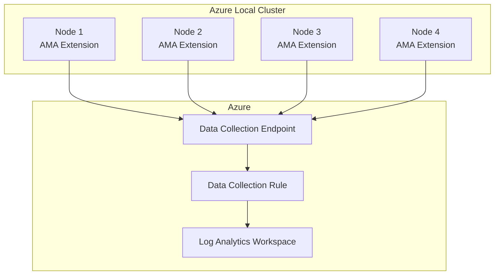

import Tabs from '@theme/Tabs';
import TabItem from '@theme/TabItem';

# Task 02: Configure Azure Monitor Agent

[](./index.mdx)
[](https://learn.microsoft.com/en-us/azure/azure-local/)

> **DOCUMENT CATEGORY**: Runbook   
> **SCOPE**: Azure Monitor Agent deployment and DCR configuration   
> **PURPOSE**: Deploy AMA to cluster nodes and configure data collection   
> **MASTER REFERENCE**: [Microsoft Learn - Azure Monitor Agent](https://learn.microsoft.com/en-us/azure/azure-monitor/agents/azure-monitor-agent-overview)

**Status**: Active

The Azure Monitor Agent (AMA) is the modern, unified agent for collecting monitoring data from Azure Local cluster nodes. It replaces the legacy Log Analytics agent and provides enhanced security, performance, and data collection capabilities through Data Collection Rules (DCRs).

## Prerequisites

| Requirement | Description | Validation |
|-------------|-------------|------------|
| Log Analytics Workspace | Created in Step 1 | Workspace ID available |
| Arc-Enabled Servers | Cluster nodes registered with Azure Arc | `az connectedmachine list` |
| Data Collection Endpoint | DCE created in Step 1 | DCE resource ID available |
| RBAC Permissions | Monitoring Contributor on resource group | Role assignment verified |
| Network Connectivity | Outbound 443 to Azure Monitor endpoints | Firewall rules verified |

## Values from infrastructure.yml

The script reads these keys from `infrastructure.yml` (schema 5). Each key, with its type, default and example, is in the [variables reference](https://github.com/AzureLocal/azurelocal-toolkit/blob/main/config/variables/docs/VARIABLES.md).

```text
azure.tenant_id, azure.subscription_id, azure.resource_group, cluster.name
operations.monitoring.enabled                    false means: do nothing
```

## Overview



## Configuration Options

<Tabs groupId="deployment-method">
<TabItem value="manual" label="Azure Portal" default>

#### Step 2.1: Install AMA Extension on Cluster Nodes

1. Navigate to **Azure Portal** → **Azure Arc** → **Servers**
2. Select each cluster node (e.g., `{{CLUSTER_NODE_01_NAME}}`)
3. Go to **Settings** → **Extensions**
4. Click **+ Add** → Search for **Azure Monitor Agent**
5. Click **Create** and configure:

| Setting | Value |
|---------|-------|
| **Subscription** | `{{AZURE_SUBSCRIPTION_NAME}}` |
| **Resource Group** | `{{AZURE_RESOURCE_GROUP}}` |

6. Repeat for all cluster nodes

> **Tip**: When you enable HCI Insights (Step 3), AMA is automatically installed on all cluster nodes.

#### Step 2.2: Data Collection Rule (created by Insights, Task 03)

Do not build the data collection rule of Insights by hand. Microsoft Learn ([Monitor a single Azure Local system with Insights](https://learn.microsoft.com/en-us/azure/azure-local/manage/monitor-single-23h2?view=azloc-2611#enable-insights)) strongly recommends against creating your own rule: the rule Insights creates includes a special data stream that Insights needs. Insights creates it (prefix `AzureStackHCI-`) when you enable Insights in [Task 03](./task-03-enable-hci-insights.mdx), and you can edit that rule later to collect more data.

Learn lists what the rule collects; [Task 03](./task-03-enable-hci-insights.mdx) checks it, read only, before it associates the rule with the nodes:

| Data | Learn's list |
|------|--------------|
| Performance counters | `Memory(*)\Available Bytes`, `Network Interface(*)\Bytes Total/sec`, `Processor(_Total)\% Processor Time`, `RDMA Activity(*)\RDMA Inbound Bytes/sec`, `RDMA Activity(*)\RDMA Outbound Bytes/sec` |
| Windows event log channels | `Microsoft-Windows-Health/Operational`, `Microsoft-Windows-SDDC-Management/Operational` |
| Destination | The Log Analytics workspace of [Task 01](./task-01-configure-log-analytics-workspace.mdx) |

</TabItem>

<TabItem value="orchestrated" label="Orchestrated Script">

### PowerShell

> **When to use**: Run the task from a management workstation or a pipeline. The script reads `infrastructure.yml` and carries no values of its own.

#### Script

| Script | What it does |
|---|---|
| `scripts/deploy/05-operational-foundations/phase-02-monitoring-observability/task-02-configure-azure-monitor-agent/powershell/Install-AzureMonitorAgent.ps1` | Installs the Azure Monitor Agent extension on the Azure Local instance that infrastructure.yml describes. Supports `-WhatIf`. |

Parameters: `-InfrastructureFile` (mandatory), `-LogPath`. It installs one extension (`AzureMonitorWindowsAgent`) on the instance through the Azure Local resource provider, which installs it on every node and on a node that joins later. It creates no data collection rule (Step 2.2) and no association ([Task 03](./task-03-enable-hci-insights.mdx)). With `operations.monitoring.enabled` false it does nothing and exits 0.

Requires: PowerShell 7; modules Az.Accounts, Az.StackHCI. Sign in first with `Connect-AzAccount -Tenant <azure.tenant_id>`.

#### Run

```powershell
./Install-AzureMonitorAgent.ps1 -InfrastructureFile ./infrastructure.yml -WhatIf
./Install-AzureMonitorAgent.ps1 -InfrastructureFile ./infrastructure.yml
```

Exit codes: `0` the extension is on the instance (installed now, already there, or planned under `-WhatIf`) or monitoring is off; `1` an Azure call or a precondition failed; `2` a value in the file is missing or not usable.

</TabItem>
<TabItem value="azure-cli" label="Azure CLI">

### Azure CLI

> **When to use**: Run the task from a host that has the Azure CLI and not the Az PowerShell modules. The script is PowerShell 7 that calls `az`; it reads `infrastructure.yml` and carries no values of its own.

#### Script

| Script | What it does |
|---|---|
| `scripts/deploy/05-operational-foundations/phase-02-monitoring-observability/task-02-configure-azure-monitor-agent/azurecli/Install-AzureMonitorAgent.azcli.ps1` | Installs the Azure Monitor Agent extension on the Azure Local instance that infrastructure.yml describes, with the Azure CLI. Supports `-WhatIf`. |

Requires: PowerShell 7 and the Azure CLI, signed in with `az login --tenant <azure.tenant_id>`. Needs the Azure CLI extension `stack-hci` (`az extension add --name stack-hci`); the script does not install it.

It installs one extension (`AzureMonitorWindowsAgent`) on the instance through the Azure Local resource provider, with `az stack-hci extension create`, which installs it on every node and on a node that joins later. It sets no automatic upgrade and creates no data collection rule. With `operations.monitoring.enabled` false it does nothing and exits 0.

#### Run

```powershell
./Install-AzureMonitorAgent.azcli.ps1 -InfrastructureFile ./infrastructure.yml -WhatIf
./Install-AzureMonitorAgent.azcli.ps1 -InfrastructureFile ./infrastructure.yml
```

</TabItem>
</Tabs>

## Associate DCR with Cluster Nodes

The association of the Insights rule with every node is done by [Task 03](./task-03-enable-hci-insights.mdx): `Enable-HciInsights.ps1` (or its Azure CLI twin) checks the rule against Learn's list above, then associates it with the Arc machine of each node under the name `<machine>-dataCollectionRuleAssociations` that the Learn policy uses. This task's script installs the agent only.

## Validation

### Verify AMA Installation

```powershell
# Check AMA extension status on all nodes
foreach ($node in $ClusterNodes) {
 $extension = Get-AzConnectedMachineExtension `
 -ResourceGroupName $ResourceGroup `
 -MachineName $node `
 -Name "AzureMonitorWindowsAgent"
 
 if ($extension.ProvisioningState -eq "Succeeded") {
 Write-Host "✅ $node - AMA installed successfully" -ForegroundColor Green
 } else {
 Write-Host "❌ $node - AMA status: $($extension.ProvisioningState)" -ForegroundColor Red
 }
}
```

### Verify Data Collection

Wait 5-10 minutes after configuration, then verify data is flowing:

```kusto
// Run in Log Analytics workspace
Heartbeat
| where Computer in ("{{CLUSTER_NODE_01_NAME}}", "{{CLUSTER_NODE_02_NAME}}")
| where TimeGenerated > ago(30m)
| summarize LastHeartbeat = max(TimeGenerated) by Computer
| order by Computer asc
```

### Verify Performance Data

```kusto
// Check performance counter collection
Perf
| where Computer in ("{{CLUSTER_NODE_01_NAME}}", "{{CLUSTER_NODE_02_NAME}}")
| where TimeGenerated > ago(1h)
| summarize Count = count() by Computer, ObjectName
| order by Computer, ObjectName
```

## Troubleshooting

| Issue | Possible Cause | Resolution |
|-------|---------------|------------|
| AMA installation fails | Arc agent not healthy | Run `azcmagent show` on node |
| No data in workspace | DCR not associated | Verify DCR associations |
| Extension timeout | Network connectivity | Check firewall rules for Azure Monitor endpoints |
| Duplicate data | Legacy agent still running | Remove Log Analytics agent |

### Required Endpoints

Ensure these endpoints are accessible from cluster nodes:

| Endpoint | Port | Purpose |
|----------|------|---------|
| `*.ods.opinsights.azure.com` | 443 | Data ingestion |
| `*.oms.opinsights.azure.com` | 443 | Agent management |
| `*.monitoring.azure.com` | 443 | Metrics ingestion |
| `*.handler.control.monitor.azure.com` | 443 | DCR configuration |

## Variables Reference

| Variable | Description | Example |
|----------|-------------|---------|
| `{{CLUSTER_NODE_01_NAME}}` | First cluster node hostname | `azl-dal-n01` |
| `{{CLUSTER_NODE_02_NAME}}` | Second cluster node hostname | `azl-dal-n02` |
| `{{LOG_ANALYTICS_WORKSPACE_NAME}}` | Workspace name | `law-azl-dal-prod-01` |
| `{{SITE_CODE}}` | Site identifier | `dal` |

## Next Steps

After configuring Azure Monitor Agent:

1. ➡️ **[Task 3: Enable HCI Insights](./task-03-enable-hci-insights.mdx)** — Enable the Insights workbook
2. Verify data collection is working before enabling Insights
3. Create baseline queries for operational monitoring

---


:::info Toolkit Reference
Scripts for this task are located in the [azurelocal-toolkit](https://github.com/AzureLocal/azurelocal-toolkit) repository under scripts/deploy/ in the appropriate task folder.
:::

---

## Alternatives

The procedures in this task use the methods shown in the tabs above. The toolkit is PowerShell 7 only and has no Bash scripts. A few tasks that act on Azure also have an Azure CLI script written in PowerShell. The [script status](https://github.com/AzureLocal/azurelocal-toolkit/blob/main/docs/script-status.md) page of the toolkit lists which task has which script.

## Navigation

| Previous | Up | Next |
|----------|-----|------|
| [← Task 01: Log Analytics Workspace](./task-01-configure-log-analytics-workspace.mdx) | [Phase 02: Monitoring & Observability](./index.mdx) | [Task 03: HCI Insights →](./task-03-enable-hci-insights.mdx) |

---

| Version | Date | Author | Changes |
|---------|------|--------|---------|
| 1.0.0 | 2026-03-24 | Azure Local Cloud | Initial release |

---

## Version Control

| Version | Date | Author | Changes |
|---------|------|--------|---------|
| 1.0.0 | 2025-03-25 | Azure Local Cloud | Initial release |
| 1.1.0 | 2026-11-16 | Azure Local Cloud | Step 2.2 follows Learn (Insights creates the rule; Task 03 checks and associates it); script parameters and exit codes |
