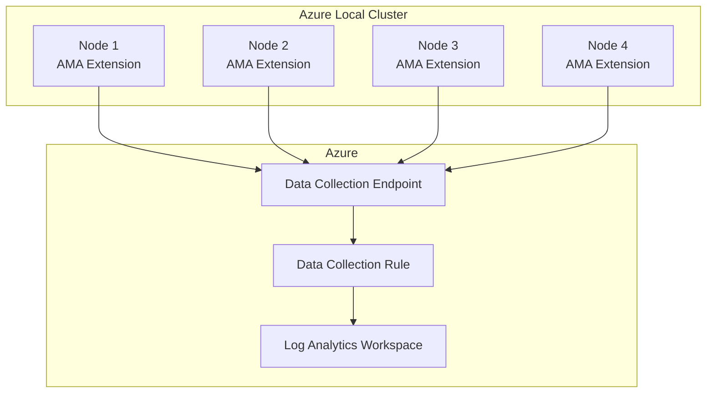

import Tabs from '@theme/Tabs';
import TabItem from '@theme/TabItem';

# Task 02: Configure Azure Monitor Agent

[](./index.mdx)
[](https://learn.microsoft.com/en-us/azure/azure-local/)

> **DOCUMENT CATEGORY**: Runbook   
> **SCOPE**: Azure Monitor Agent deployment and DCR configuration   
> **PURPOSE**: Deploy AMA to cluster nodes and configure data collection   
> **MASTER REFERENCE**: [Microsoft Learn - Azure Monitor Agent](https://learn.microsoft.com/en-us/azure/azure-monitor/agents/azure-monitor-agent-overview)

**Status**: Active

The Azure Monitor Agent (AMA) is the modern, unified agent for collecting monitoring data from Azure Local cluster nodes. It replaces the legacy Log Analytics agent and provides enhanced security, performance, and data collection capabilities through Data Collection Rules (DCRs).

## Prerequisites

| Requirement | Description | Validation |
|-------------|-------------|------------|
| Log Analytics Workspace | Created in Step 1 | Workspace ID available |
| Arc-Enabled Servers | Cluster nodes registered with Azure Arc | `az connectedmachine list` |
| Data Collection Endpoint | DCE created in Step 1 | DCE resource ID available |
| RBAC Permissions | Monitoring Contributor on resource group | Role assignment verified |
| Network Connectivity | Outbound 443 to Azure Monitor endpoints | Firewall rules verified |

## Values from infrastructure.yml

The script reads these keys from `infrastructure.yml` (schema 5). Each key, with its type, default and example, is in the [variables reference](https://github.com/AzureLocal/azurelocal-toolkit/blob/main/config/variables/docs/VARIABLES.md).

```text
azure.tenant_id, azure.subscription_id, azure.resource_group, cluster.name
operations.monitoring.enabled                    false means: do nothing
```

## Overview



## Configuration Options

<Tabs groupId="deployment-method">
<TabItem value="manual" label="Azure Portal" default>

#### Step 2.1: Install AMA Extension on Cluster Nodes

1. Navigate to **Azure Portal** → **Azure Arc** → **Servers**
2. Select each cluster node (e.g., `{{CLUSTER_NODE_01_NAME}}`)
3. Go to **Settings** → **Extensions**
4. Click **+ Add** → Search for **Azure Monitor Agent**
5. Click **Create** and configure:

| Setting | Value |
|---------|-------|
| **Subscription** | `{{AZURE_SUBSCRIPTION_NAME}}` |
| **Resource Group** | `{{AZURE_RESOURCE_GROUP}}` |

6. Repeat for all cluster nodes

> **Tip**: When you enable HCI Insights (Step 3), AMA is automatically installed on all cluster nodes.

#### Step 2.2: Create Data Collection Rule

1. Navigate to **Azure Monitor** → **Data Collection Rules**
2. Click **+ Create**
3. Configure **Basics**:

| Setting | Value |
|---------|-------|
| **Rule Name** | `dcr-azl-{{SITE_CODE}}-performance` |
| **Subscription** | `{{AZURE_SUBSCRIPTION_NAME}}` |
| **Resource Group** | `{{AZURE_RESOURCE_GROUP}}` |
| **Region** | `{{AZURE_REGION}}` |
| **Platform Type** | Windows |
| **Data Collection Endpoint** | `dce-{{SITE_CODE}}-azl-01` |

4. Configure **Resources** — Add all cluster nodes as Arc-enabled servers
5. Configure **Collect and deliver**:

**Data Source 1: Performance Counters**
- Type: Performance Counters
- Select counters for HCI Insights compatibility

**Data Source 2: Windows Event Logs**
- Type: Windows Event Logs
- Add: `Microsoft-Windows-Health/Operational`, `Microsoft-Windows-SDDC-Management/Operational`

6. Configure **Destination**:
- Destination Type: Azure Monitor Logs
- Subscription: `{{AZURE_SUBSCRIPTION_NAME}}`
- Log Analytics Workspace: `{{LOG_ANALYTICS_WORKSPACE_NAME}}`

7. Click **Review + Create** → **Create**

</TabItem>

<TabItem value="orchestrated" label="Orchestrated Script">

### PowerShell

> **When to use**: Run the task from a management workstation or a pipeline. The script reads `infrastructure.yml` and carries no values of its own.

#### Script

| Script | What it does |
|---|---|
| `scripts/deploy/05-operational-foundations/phase-02-monitoring-observability/task-02-configure-azure-monitor-agent/powershell/Install-AzureMonitorAgent.ps1` | Installs the Azure Monitor Agent extension on the Azure Local instance that infrastructure.yml describes. Supports `-WhatIf`. |

Requires: PowerShell 7.

#### Run

```powershell
./Install-AzureMonitorAgent.ps1 -InfrastructureFile ./infrastructure.yml -WhatIf
```

</TabItem>
</Tabs>

## Associate DCR with Cluster Nodes

After creating the DCR, associate it with each cluster node:

```powershell
# Associate DCR with each Arc-enabled server
$dcrResourceId = "/subscriptions/{{AZURE_SUBSCRIPTION_ID}}/resourceGroups/{{AZURE_RESOURCE_GROUP}}/providers/Microsoft.Insights/dataCollectionRules/dcr-azl-{{SITE_CODE}}-performance"

foreach ($node in $ClusterNodes) {
 $arcServer = Get-AzConnectedMachine -ResourceGroupName $ResourceGroup -Name $node
 
 New-AzDataCollectionRuleAssociation `
 -TargetResourceId $arcServer.Id `
 -AssociationName "assoc-$node" `
 -RuleId $dcrResourceId
 
 Write-Host "✅ DCR associated with $node" -ForegroundColor Green
}
```

## Validation

### Verify AMA Installation

```powershell
# Check AMA extension status on all nodes
foreach ($node in $ClusterNodes) {
 $extension = Get-AzConnectedMachineExtension `
 -ResourceGroupName $ResourceGroup `
 -MachineName $node `
 -Name "AzureMonitorWindowsAgent"
 
 if ($extension.ProvisioningState -eq "Succeeded") {
 Write-Host "✅ $node - AMA installed successfully" -ForegroundColor Green
 } else {
 Write-Host "❌ $node - AMA status: $($extension.ProvisioningState)" -ForegroundColor Red
 }
}
```

### Verify Data Collection

Wait 5-10 minutes after configuration, then verify data is flowing:

```kusto
// Run in Log Analytics workspace
Heartbeat
| where Computer in ("{{CLUSTER_NODE_01_NAME}}", "{{CLUSTER_NODE_02_NAME}}")
| where TimeGenerated > ago(30m)
| summarize LastHeartbeat = max(TimeGenerated) by Computer
| order by Computer asc
```

### Verify Performance Data

```kusto
// Check performance counter collection
Perf
| where Computer in ("{{CLUSTER_NODE_01_NAME}}", "{{CLUSTER_NODE_02_NAME}}")
| where TimeGenerated > ago(1h)
| summarize Count = count() by Computer, ObjectName
| order by Computer, ObjectName
```

## Troubleshooting

| Issue | Possible Cause | Resolution |
|-------|---------------|------------|
| AMA installation fails | Arc agent not healthy | Run `azcmagent show` on node |
| No data in workspace | DCR not associated | Verify DCR associations |
| Extension timeout | Network connectivity | Check firewall rules for Azure Monitor endpoints |
| Duplicate data | Legacy agent still running | Remove Log Analytics agent |

### Required Endpoints

Ensure these endpoints are accessible from cluster nodes:

| Endpoint | Port | Purpose |
|----------|------|---------|
| `*.ods.opinsights.azure.com` | 443 | Data ingestion |
| `*.oms.opinsights.azure.com` | 443 | Agent management |
| `*.monitoring.azure.com` | 443 | Metrics ingestion |
| `*.handler.control.monitor.azure.com` | 443 | DCR configuration |

## Variables Reference

| Variable | Description | Example |
|----------|-------------|---------|
| `{{CLUSTER_NODE_01_NAME}}` | First cluster node hostname | `azl-dal-n01` |
| `{{CLUSTER_NODE_02_NAME}}` | Second cluster node hostname | `azl-dal-n02` |
| `{{LOG_ANALYTICS_WORKSPACE_NAME}}` | Workspace name | `law-azl-dal-prod-01` |
| `{{SITE_CODE}}` | Site identifier | `dal` |

## Next Steps

After configuring Azure Monitor Agent:

1. ➡️ **[Task 3: Enable HCI Insights](./task-03-enable-hci-insights.mdx)** — Enable the Insights workbook
2. Verify data collection is working before enabling Insights
3. Create baseline queries for operational monitoring

---


:::info Toolkit Reference
Scripts for this task are located in the [azurelocal-toolkit](https://github.com/AzureLocal/azurelocal-toolkit) repository under scripts/deploy/ in the appropriate task folder.
:::

---

## Alternatives

The procedures in this task use the methods shown in the tabs above. The toolkit is PowerShell 7 only and has no Bash scripts. A few tasks that act on Azure also have an Azure CLI script written in PowerShell. The [script status](https://github.com/AzureLocal/azurelocal-toolkit/blob/main/docs/script-status.md) page of the toolkit lists which task has which script.

## Navigation

| Previous | Up | Next |
|----------|-----|------|
| [← Task 01: Log Analytics Workspace](./task-01-configure-log-analytics-workspace.mdx) | [Phase 02: Monitoring & Observability](./index.mdx) | [Task 03: HCI Insights →](./task-03-enable-hci-insights.mdx) |

---

| Version | Date | Author | Changes |
|---------|------|--------|---------|
| 1.0.0 | 2026-03-24 | Azure Local Cloud | Initial release |

---

## Version Control

| Version | Date | Author | Changes |
|---------|------|--------|---------|
| 1.0.0 | 2025-03-25 | Azure Local Cloud | Initial release |
